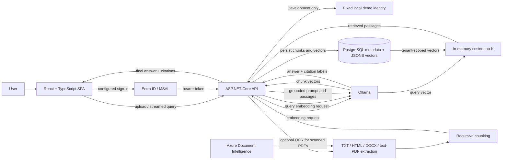
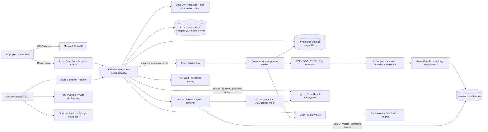

# Enterprise RAG Platform — architecture and implementation blueprint

## Scope and implementation status

The runnable path is local: .NET 9 API, React/TypeScript UI, Development-only demo identity or configured Entra JWT/role policies, TXT/HTML/DOCX/text-based PDF extraction, recursive chunking, Ollama chat/embeddings, PostgreSQL chunks and JSONB vectors, tenant-filtered cosine scoring in API memory, and Docker Compose. Original uploads are not retained, ingestion is synchronous, and the PostgreSQL retriever does not enforce document-level group ACLs. The API returns citations mapped to retrieved chunks; confidence remains `0`.

Azure OpenAI/Semantic Kernel, Azure AI Search query, and Document Intelligence OCR adapters exist, but no complete Azure environment is provisioned. The Azure Search adapter has no index writer/lifecycle; Blob Storage and Service Bus clients are registered but not used by ingestion; and the Azure provider needs complete service wiring. Production-scale indexing, reliable background ingestion, calibrated confidence, scored evaluation, and production security/operations remain future work. `/health/ready` currently checks the configured local Ollama/PostgreSQL path, not general Azure readiness.

**Runtime target:** the code targets .NET 9 because that was requested. .NET 9 support ended on May 12, 2026; move to .NET 10 LTS before production use or exposing the service publicly. The .NET 9 target is retained to match the original project constraint.

## Current local runtime diagram



The local query retrieves candidate vectors for the current tenant, scores them in memory, and passes the top passages to the configured answer model. The diagram does not imply group-level authorization or a deployed cloud OCR service.

## Future Azure target architecture (not deployed)

The following diagram and request flow are a proposed production direction, not the current application wiring. Complete the index-write lifecycle, queue worker, authorization, and operational controls before treating this as an end-to-end design.



### Proposed cloud request and ingestion flow

1. The SPA signs in with Entra ID and requests an API token. The API validates issuer, audience, tenant, lifetime, and signature; API roles—not client-side visibility—authorize queries and ingestion.
2. The API derives tenant, subject, and groups from validated claims. After a Search index writer is implemented, ingestion should store private originals, enqueue a durable job, extract/chunk/embed in a worker, and upsert ACL-bearing chunks into a versioned index.
3. Search should apply mandatory tenant and document/group filters before returning candidates; hybrid lexical/vector retrieval and semantic ranking are design targets. The current Azure retriever is query-only and does not provide index lifecycle operations.
4. A grounded generator should receive only permitted, filtered passages, cite stable retrieved chunk IDs, and abstain when evidence is insufficient. Calibrated confidence, query rewriting, reranking, and application context filtering are not implemented end to end.
5. Instrument operations with privacy-safe traces and metrics, add cost controls and evaluation gates, and validate backup/recovery and service objectives before production rollout.

## Folder structure

```text
.
├── Controllers/                         # HTTP boundary; request/response validation
├── src/
│   ├── Enterprise.Rag.Domain/           # Entities and domain invariants
│   ├── Enterprise.Rag.Application/      # Use-case ports, contracts, chunking policy
│   └── Enterprise.Rag.Infrastructure/   # Local Ollama/Postgres and Azure integration adapters
├── frontend/                            # React + TypeScript SPA
├── db/schema.sql                        # PostgreSQL DDL and tenant RLS policies
├── docs/architecture.md                 # Diagrams, schema, rollout and security design
├── .github/workflows/                   # CI and OIDC deployment workflows
├── Dockerfile                            # API image
├── docker-compose.yml                    # Local API + PostgreSQL + frontend
└── Enterprise-RAG-Platform.csproj        # API host
```

## Implemented code relationships

This diagram shows the core local path and the available provider implementations. Query enhancement, dedicated reranking, and context-filter interfaces are not wired into the local orchestrator.

```mermaid
classDiagram
	class DocumentsController
	class RagController
	class IDocumentIngestionService {
		<<interface>>
		+IndexAsync(stream, fileName, contentType, securityContext) DocumentIndexResult
	}
	class IRagOrchestrator {
		<<interface>>
		+QueryAsync(query, securityContext) RagAnswer
	}
	class IDocumentTextExtractor {
		<<interface>>
		+ExtractAsync(stream, fileName) string
	}
	class IDocumentChunker {
		<<interface>>
		+Chunk(document, text, target, overlap) DocumentChunk[]
	}
	class IEmbeddingGenerator {
		<<interface>>
		+GenerateAsync(texts) vectors
	}
	class IDocumentIndexStore {
		<<interface>>
		+SaveAsync(document, chunks, embeddings) documentId
	}
	class IHybridRetriever {
		<<interface>>
		+SearchAsync(query, securityContext) RetrievedChunk[]
	}
	class IGroundedAnswerGenerator {
		<<interface>>
		+GenerateAsync(query, evidence) RagAnswer
	}
	class DocumentIngestionService
	class RagOrchestrator
	class OllamaEmbeddingGenerator
	class AzureOpenAIEmbeddingGenerator
	class PostgresDocumentIndexStore
	class PostgresVectorRetriever
	class AzureAiSearchHybridRetriever
	class OllamaGroundedAnswerGenerator
	class SemanticKernelGroundedAnswerGenerator
	DocumentsController --> IDocumentIngestionService
	RagController --> IRagOrchestrator
	DocumentIngestionService ..|> IDocumentIngestionService
	DocumentIngestionService --> IDocumentTextExtractor
	DocumentIngestionService --> IDocumentChunker
	DocumentIngestionService --> IEmbeddingGenerator
	DocumentIngestionService --> IDocumentIndexStore
	RagOrchestrator ..|> IRagOrchestrator
	RagOrchestrator --> IHybridRetriever
	RagOrchestrator --> IGroundedAnswerGenerator
	OllamaEmbeddingGenerator ..|> IEmbeddingGenerator
	AzureOpenAIEmbeddingGenerator ..|> IEmbeddingGenerator
	PostgresDocumentIndexStore ..|> IDocumentIndexStore
	PostgresVectorRetriever ..|> IHybridRetriever
	AzureAiSearchHybridRetriever ..|> IHybridRetriever
	OllamaGroundedAnswerGenerator ..|> IGroundedAnswerGenerator
	SemanticKernelGroundedAnswerGenerator ..|> IGroundedAnswerGenerator
```



## PostgreSQL schema and ownership

`db/schema.sql` creates:

- `documents`: tenant-scoped metadata, SHA-256, status, and a `blob_uri` field. The local uploader currently writes a `local://` identifier; it does not persist the original file in Blob Storage.
- `document_chunks`: extracted chunk text, ordinal/page, JSONB metadata, and JSONB embeddings. The local retriever reads these vectors and scores them in application memory. Azure AI Search is not the current source of indexed chunks.
- `chat_sessions` and `chat_messages`: tables for future conversation persistence; current query requests do not write chat history.
- `evaluation_runs` and `usage_events`: tables for future quality and usage tracking; no current evaluation or token/cost ledger writes to them.

Tenant isolation policies are enabled and forced for every table. Local PostgreSQL operations set `app.tenant_id` inside the database transaction; production deployments must validate identity claims before setting it, use a non-owner runtime role, and keep migrations under a separate owner. Back up PostgreSQL with PITR, encrypt at rest, and test restore procedures.

## Azure AI Search index contract

Use a versioned index (for example `knowledge-v1`) with fields: `chunkId` (key), `tenantId` (filterable), `documentId` (filterable), `groupIds` (filterable collection), `isTenantWide` (filterable boolean), `fileName`, `contentType`, `title`, `content` (searchable), `pageNumber`, `ordinal`, `metadata` (retrievable/filterable as needed), and `contentVector` (vector field whose dimensions exactly match the embedding deployment). Configure a semantic configuration over title/content and an HNSW vector profile.

## Chunking and ingestion policy

- Allow PDF, DOCX, TXT, and HTML only; enforce byte-size, extension, MIME, and content-signature checks, malware scanning, decompression limits, and per-tenant quotas before parsing.
- Extract PDF text/page metadata (use Azure AI Document Intelligence for OCR/scanned files); DOCX via Open XML; TXT with strict UTF-8 detection; HTML after script/style removal and safe text extraction. Do not fetch arbitrary embedded URLs during parsing.
- `RecursiveTextChunker` is a dependency-free starter implementation. Production token-aware chunking should use recursive separators (document structure → paragraphs → sentences → words), overlap, and page/heading metadata. Semantic chunking should use adjacent-sentence embeddings and a measured similarity boundary threshold; compare retrieval quality against recursive chunking before enabling it.
- Enrich every chunk with tenant, source/document ID, filename, content type, page, heading, creation time, ACL/group IDs, and parser version. Store a stable chunk ID and content hash for idempotent upsert and deletion.
- Queue indexing, retry transient failures with bounded exponential backoff, dead-letter poison documents, and expose status/progress. Deletion must remove Blob, PostgreSQL rows, and Search documents (including all old index versions).

## Retrieval, answer, and evaluation

- Retrieval modes: lexical/BM25, vector, and hybrid; default to hybrid with semantic ranker where provisioned. Search options should be configuration-driven and recorded in telemetry.
- Advanced RAG: rewrite and expand queries with bounded calls; deduplicate candidates; rerank; apply tenant/group ACL and relevance/context-size filters before generation.
- Grounding: pass numbered evidence snippets with stable chunk IDs; instruct Semantic Kernel/Azure OpenAI to cite IDs only, never invent sources, and abstain if the evidence cannot answer. Resolve citation IDs to document/page links server-side.
- Confidence: produce a calibrated score from retrieval score, reranker score, evidence coverage, and answer/citation consistency, validated against a labeled dataset. Do not treat raw LLM probability or self-rating as a confidence score.
- Evaluation suite: faithfulness and hallucination detection compare answer claims with evidence; answer relevancy scores query-answer alignment; context precision measures relevant retrieved passages; context recall measures coverage of reference evidence. Run offline golden-set evaluations on each prompt/index/model change and online sampled evaluation with privacy controls.

## Security and operations

- Entra ID OAuth2/OIDC: outside the explicit local demo mode, the API validates bearer tokens with Microsoft.Identity.Web and protects query calls with `Rag.Query`/`Rag.Admin` and document upload with `Rag.Ingest`/`Rag.Admin`. The React SPA uses MSAL with authorization-code/PKCE flows, silent token acquisition first, and popup interaction when consent or sign-in is required. Configure the real API audience, tenant restrictions, app roles (`Rag.Query`, `Rag.Ingest`, `Rag.Admin`), delegated SPA scope, and default-deny all data routes except health endpoints. Derive tenant/user/groups only from validated API claims. Frontend authorization is never a substitute for API authorization. Supply only public client ID, tenant ID, API scope, and API URL as `VITE_*` build settings; never put secrets there.
- Local demo authentication: `LOCAL_DEMO_AUTH=true` selects a fixed `local-demo` identity only when `ASPNETCORE_ENVIRONMENT=Development`; it grants `Rag.Query` and `Rag.Ingest` without validating a token. Compose binds UI, API, and PostgreSQL to host loopback only. Do not enable this mode outside local development or expose these ports to an untrusted network. Set `LOCAL_DEMO_AUTH=false` to use Entra authentication.
- Local model option: `Rag:Provider=Ollama` uses Ollama `/api/chat` and `/api/embed`; Compose reaches a host-installed Ollama service at `host.docker.internal:11434`. The local PostgreSQL prototype stores vectors as JSONB and scans the current tenant's chunks to calculate cosine similarity in API memory. This is intentionally for small development datasets, not production-scale vector retrieval. The local retriever does not apply group/document ACL filters. Use a dedicated vector index for production; maintain a fixed embedding model per index and re-index when it changes. `scripts/export_hf_amnesty_contexts.py` exports only retrieved context passages from the English v3 split of the Apache-2.0-tagged Hugging Face Amnesty QA dataset for a small local demo.
- Use managed identities for Container Apps to access Key Vault, Blob, Search, Azure OpenAI, Service Bus, ACR, and Monitor. Prefer data-plane RBAC; no shared keys in appsettings, images, GitHub variables, logs, or local commits. Use private endpoints/VNet integration, private DNS, TLS, WAF, and restricted CORS.
- OpenTelemetry: instrument ASP.NET Core, HttpClient, database and queue operations; propagate W3C trace context across queue messages; export OTLP to Azure Monitor/Application Insights. Add low-cardinality metrics for request latency, retrieval counts, model token usage/cost, ingestion state, and evaluation scores. Never use tenant/user/document IDs as metric labels.
- Cost controls: per-tenant quotas, upload/query rate limits, max query expansions, top-K and context token ceilings, model deployment limits, cache only permission-safe results, and alert on token spend/429s.
- Availability: multi-zone Container Apps and PostgreSQL where supported; queue-backed ingestion; health probes; graceful degradation with explicit 503/429; backups/PITR; reindex and restore runbooks; regional failover design based on required RTO/RPO.

## CI/CD and deployment

GitHub Actions should build/test the .NET solution and TypeScript app on every PR, run formatting/static/security checks and dependency scanning, then publish immutable API images to ACR. Use GitHub OIDC (`azure/login`) instead of long-lived service-principal secrets. Deploy to a staging Container Apps environment, run database migrations as a one-off job, smoke-test readiness and protected API behavior, require environment approval, then promote the same digest to production. Publish the React SPA to Static Web Apps or private Storage behind Front Door. Use versioned SQL migrations and blue/green or revision traffic shifting; never deploy destructive schema changes without expand/migrate/contract sequencing.

Suggested environments: separate subscriptions or resource groups for dev/test/prod; hub/spoke VNet with private endpoints; Front Door Premium WAF; Container Apps environment with internal API ingress; private PostgreSQL Flexible Server; private Storage, Key Vault, Search and Service Bus; Azure Monitor workspace/Application Insights; ACR; Azure Policy and resource locks for production.

## Step-by-step integration plan

1. Confirm tenant model, data classification, file/size limits, throughput, residency, RPO/RTO, and model availability; move the application target to supported .NET 10 LTS before production.
2. Provision isolated dev/test Azure resources with private networking, managed identities, Key Vault, Entra app roles, PostgreSQL, Blob, Service Bus, Search, Azure OpenAI chat/embedding deployments, Document Intelligence if OCR is needed, and Monitor.
3. Complete Entra claim mapping and API authorization tests. Query requires `Rag.Query`/`Rag.Admin`; upload requires `Rag.Ingest`/`Rag.Admin`. Configure real SPA/API registrations, delegated scope, roles, audience, and CORS. Test cross-tenant access and do not assume the local PostgreSQL retriever enforces group ACLs.
4. Finish provider wiring before selecting Azure OpenAI in production: configure `Rag:Provider=AzureOpenAI`, `AzureOpenAI:Endpoint`, `AzureOpenAI:ChatDeployment`, and `AzureOpenAI:EmbeddingDeployment`; provide a managed identity with least privilege; register Azure-compatible ingestion and orchestration services; and verify model/vector dimensions. The current DI path does not provide a complete Azure ingestion/query runtime.
5. Provision a versioned Azure AI Search index with tenant/group ACL fields, semantic configuration, and a vector field matching the embedding dimensions. Implement chunk upsert, update, delete, reindex, and index-version migration; connect those operations to ingestion. The existing Search adapter only queries an index and is not an index writer.
6. Add private Blob source storage and a queue-backed worker. Publish idempotent jobs, record lifecycle state, implement bounded retries/dead-letter handling, malware/signature checks, cancellation, and coordinated removal from Blob, PostgreSQL, and Search. Blob and Service Bus clients are currently registered but unused by application workflows.
7. Extend beyond the local path with OCR as needed, retrieval tuning (hybrid search, reranking, context filters), server-side citation resolution, calibrated confidence, and conversation persistence. Keep capabilities feature-tested rather than assuming adapter presence implies end-to-end behavior.
8. Create a versioned labeled evaluation set; implement faithfulness, relevancy, context precision/recall, and hallucination checks. Establish regression thresholds for changes to prompts, models, chunking, and indexes.
9. Add privacy-safe OpenTelemetry traces/metrics, cost and latency controls, alerts, operational runbooks, load/security tests, backup/restore drills, and failover validation.
10. Complete GitHub Actions OIDC CI/CD with staging gates, migration sequencing, immutable image promotion, and gradual rollout. Verify authorization, tenant isolation, ingestion, retrieval, citations, costs, and service objectives before production traffic.
