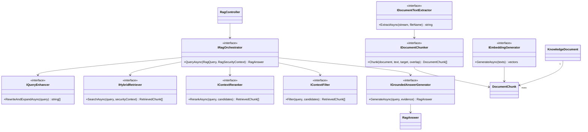

# Enterprise RAG Platform — architecture and implementation blueprint

## Scope and implementation status

This repository contains the .NET 9 API shell, Domain/Application/Infrastructure project boundaries, Entra JWT validation with `Rag.Query`/`Rag.Admin` authorization, configurable managed-identity Azure clients, Semantic Kernel embedding/grounded-generation adapters, Azure AI Search hybrid retrieval, TXT/HTML/DOCX/PDF extraction adapters, a recursive text chunker, a React UI starter, PostgreSQL schema, and container/workflow scaffolding. The query endpoint still returns HTTP 503 after authorization: the end-to-end orchestrator, upload workflow, tenant-scoped persistence, index lifecycle, semantic chunker, evaluation engine, and live cloud resources are not wired. `/health/live` is the liveness probe; `/health/ready` deliberately reports unavailable until those remaining components exist.

**Runtime target:** the code targets .NET 9 because that was requested. .NET 9 support ended on May 12, 2026; for a production launch on the current date, move to .NET 10 LTS before exposing the service publicly. The .NET 9 target is retained here to match the stated constraint.

## Architecture diagram


### Request flow

1. React authenticates with Entra ID and requests an API access token. The API validates issuer, audience, tenant, lifetime, and signature; app roles authorize query and ingestion separately.
2. The API derives tenant, subject, and groups from validated claims—not request-body fields. It rewrites/expands the question (bounded to a small configurable count), produces an embedding, and submits hybrid text+vector search with a mandatory tenant/ACL filter.
3. Azure AI Search merges BM25 and vector candidates using RRF. Semantic ranker reranks the top candidates; a second application reranker and context filter remove irrelevant, duplicate, or unauthorized passages.
4. Semantic Kernel calls the configured Azure OpenAI chat deployment with only the filtered evidence. The prompt requires source-grounded claims, explicit abstention when evidence is insufficient, and citations that refer only to retrieved chunk IDs.
5. The response includes citations and a calibrated confidence value computed from retrieval/reranker evidence and coverage—not a model's self-reported confidence. Trace, token counts, deployment, latency, and cost estimate are recorded without logging raw prompt/document content by default.
6. Document upload streams to private Blob Storage; a queue decouples extraction, chunking, embedding, indexing, retry, and dead-letter handling from the API request.

## Folder structure

```text
.
├── Controllers/                         # HTTP boundary; request/response validation
├── src/
│   ├── Enterprise.Rag.Domain/           # Entities and domain invariants
│   ├── Enterprise.Rag.Application/      # Use-case ports, contracts, chunking policy
│   └── Enterprise.Rag.Infrastructure/   # Azure/Postgres adapters (to be implemented)
├── frontend/                            # React + TypeScript SPA
├── db/schema.sql                        # PostgreSQL DDL and tenant RLS policies
├── docs/architecture.md                 # Diagrams, schema, rollout and security design
├── .github/workflows/                   # CI and OIDC deployment workflows
├── Dockerfile                            # API image
├── docker-compose.yml                    # Local API + PostgreSQL + frontend
└── Enterprise-RAG-Platform.csproj        # API host
```

## Class diagram



## PostgreSQL schema and ownership

`db/schema.sql` creates:

- `documents`: tenant-scoped upload metadata, content hash, private Blob URI, ingestion status, and idempotency key.
- `document_chunks`: chunk text, ordinal/page, and JSONB enrichment metadata. Search vectors are in Azure AI Search; PostgreSQL is the transactional metadata/audit source of truth.
- `chat_sessions` and `chat_messages`: tenant/subject-scoped conversation state and citation payloads.
- `evaluation_runs`: faithfulness, relevancy, context precision/recall, hallucination flag, evaluator version, and details.
- `usage_events`: model deployment, operation, input/output token counts, trace ID, and estimated charge.

Tenant isolation policies are enabled and forced for all tenant tables. Runtime code must set `SET LOCAL app.tenant_id` within each transaction only after validating identity claims. Run migrations with a separate owner; runtime identities must not own tables or bypass RLS. Back up PostgreSQL with PITR, encrypt at rest, and test restore procedures.

## Azure AI Search index contract

Use a versioned index (for example `knowledge-v1`) with fields: `chunkId` (key), `tenantId` (filterable), `documentId` (filterable), `groupIds` (filterable collection), `isTenantWide` (filterable boolean), `fileName`, `contentType`, `title`, `content` (searchable), `pageNumber`, `ordinal`, `metadata` (retrievable/filterable as needed), and `contentVector` (vector field whose dimensions exactly match the embedding deployment). Configure a semantic configuration over title/content and an HNSW vector profile.

## Chunking and ingestion policy

- Allow PDF, DOCX, TXT, and HTML only; enforce byte-size, extension, MIME, and content-signature checks, malware scanning, decompression limits, and per-tenant quotas before parsing.
- Extract PDF text/page metadata (use Azure AI Document Intelligence for OCR/scanned files); DOCX via Open XML; TXT with strict UTF-8 detection; HTML after script/style removal and safe text extraction. Do not fetch arbitrary embedded URLs during parsing.
- `RecursiveTextChunker` is a dependency-free starter implementation. Production token-aware chunking should use recursive separators (document structure → paragraphs → sentences → words), overlap, and page/heading metadata. Semantic chunking should use adjacent-sentence embeddings and a measured similarity boundary threshold; compare retrieval quality against recursive chunking before enabling it.
- Enrich every chunk with tenant, source/document ID, filename, content type, page, heading, creation time, ACL/group IDs, and parser version. Store a stable chunk ID and content hash for idempotent upsert and deletion.
- Queue indexing, retry transient failures with bounded exponential backoff, dead-letter poison documents, and expose status/progress. Deletion must remove Blob, PostgreSQL rows, and Search documents (including all old index versions).

## Retrieval, answer, and evaluation

- Retrieval modes: lexical/BM25, vector, and hybrid; default to hybrid with semantic ranker where provisioned. Search options should be configuration-driven and recorded in telemetry.
- Advanced RAG: rewrite and expand queries with bounded calls; deduplicate candidates; rerank; apply tenant/group ACL and relevance/context-size filters before generation.
- Grounding: pass numbered evidence snippets with stable chunk IDs; instruct Semantic Kernel/Azure OpenAI to cite IDs only, never invent sources, and abstain if the evidence cannot answer. Resolve citation IDs to document/page links server-side.
- Confidence: produce a calibrated score from retrieval score, reranker score, evidence coverage, and answer/citation consistency, validated against a labeled dataset. Do not treat raw LLM probability or self-rating as a confidence score.
- Evaluation suite: faithfulness and hallucination detection compare answer claims with evidence; answer relevancy scores query-answer alignment; context precision measures relevant retrieved passages; context recall measures coverage of reference evidence. Run offline golden-set evaluations on each prompt/index/model change and online sampled evaluation with privacy controls.

## Security and operations

- Entra ID OAuth2/OIDC: the API validates bearer tokens with Microsoft.Identity.Web and protects query calls with `Rag.Query` or `Rag.Admin`. The React SPA uses MSAL with authorization-code/PKCE flows, silent token acquisition first, and popup interaction when consent or sign-in is required. Configure the real API audience, tenant restrictions, app roles (`Rag.Query`, `Rag.Ingest`, `Rag.Admin`), delegated SPA scope, and default-deny all data routes except health endpoints. Derive tenant/user/groups only from validated API claims. Frontend authorization is never a substitute for API authorization. Supply only public client ID, tenant ID, API scope, and API URL as `VITE_*` build settings; never put secrets there.
- Use managed identities for Container Apps to access Key Vault, Blob, Search, Azure OpenAI, Service Bus, ACR, and Monitor. Prefer data-plane RBAC; no shared keys in appsettings, images, GitHub variables, logs, or local commits. Use private endpoints/VNet integration, private DNS, TLS, WAF, and restricted CORS.
- OpenTelemetry: instrument ASP.NET Core, HttpClient, database and queue operations; propagate W3C trace context across queue messages; export OTLP to Azure Monitor/Application Insights. Add low-cardinality metrics for request latency, retrieval counts, model token usage/cost, ingestion state, and evaluation scores. Never use tenant/user/document IDs as metric labels.
- Cost controls: per-tenant quotas, upload/query rate limits, max query expansions, top-K and context token ceilings, model deployment limits, cache only permission-safe results, and alert on token spend/429s.
- Availability: multi-zone Container Apps and PostgreSQL where supported; queue-backed ingestion; health probes; graceful degradation with explicit 503/429; backups/PITR; reindex and restore runbooks; regional failover design based on required RTO/RPO.

## CI/CD and deployment

GitHub Actions should build/test the .NET solution and TypeScript app on every PR, run formatting/static/security checks and dependency scanning, then publish immutable API images to ACR. Use GitHub OIDC (`azure/login`) instead of long-lived service-principal secrets. Deploy to a staging Container Apps environment, run database migrations as a one-off job, smoke-test readiness and protected API behavior, require environment approval, then promote the same digest to production. Publish the React SPA to Static Web Apps or private Storage behind Front Door. Use versioned SQL migrations and blue/green or revision traffic shifting; never deploy destructive schema changes without expand/migrate/contract sequencing.

Suggested environments: separate subscriptions or resource groups for dev/test/prod; hub/spoke VNet with private endpoints; Front Door Premium WAF; Container Apps environment with internal API ingress; private PostgreSQL Flexible Server; private Storage, Key Vault, Search and Service Bus; Azure Monitor workspace/Application Insights; ACR; Azure Policy and resource locks for production.

## Step-by-step implementation plan

1. Confirm tenant model, data classification, file/size limits, expected throughput, residency, RPO/RTO, and model deployment availability; move target framework to supported .NET 10 LTS before production.
2. Provision dev/test Azure resources with private networking, managed identities, Key Vault, Entra app roles, PostgreSQL, Blob, Service Bus, Search, Azure OpenAI chat/embedding deployments, and Monitor.
3. Review the pinned package references for Semantic Kernel/Azure OpenAI, Azure AI Search, Azure Identity, Blob Storage, Service Bus, Npgsql, Microsoft.Identity.Web, Azure Monitor OpenTelemetry, Document Intelligence, OpenXML, and HTML parsing; keep dependency auditing enabled and refresh versions through package manager.
4. Complete tenant claim mapping, RLS-aware PostgreSQL transactions, and authorization tests before implementing any data-returning route. The API requires a `Rag.Query` or `Rag.Admin` role; the SPA MSAL flow is scaffolded but requires real app registration, scope, role, audience, and CORS configuration.
5. Complete secure upload and idempotent asynchronous ingestion; current extractors cover PDF via Document Intelligence, DOCX, TXT, and HTML, but file signature/size/malware checks, page/heading metadata preservation, semantic chunking, and dead-letter/status handling remain to be implemented.
6. Define and version Search index schema, embedding generation, ACL fields, indexer/upsert/delete adapters, hybrid/vector/keyword search, semantic ranking, rewrite/expansion, reranking, and context filtering.
7. Implement Semantic Kernel grounded generation, server-side citation resolution, abstention, calibrated confidence, token/cost ledger, and conversation persistence.
8. Create a versioned labeled evaluation dataset; implement all five evaluator metrics and block releases when agreed thresholds regress.
9. Add OpenTelemetry spans/metrics/log correlation, dashboards, cost/latency/quality alerts, runbooks, load/security testing, and restore/failover exercises.
10. Complete GitHub Actions OIDC CI/CD with staging gates and image digest promotion; deploy gradually behind Front Door and verify auth, tenant isolation, ingestion, retrieval, citations, cost, and SLOs.
