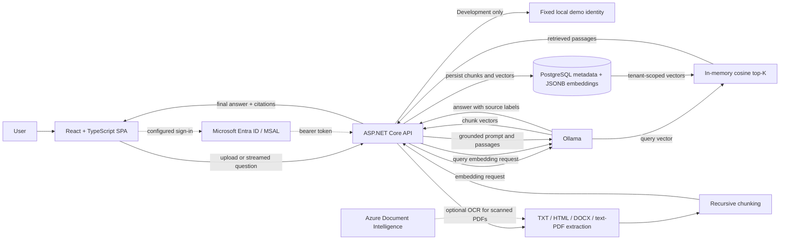

# Enterprise RAG Platform — how it works and where it can go

A local-first retrieval-augmented generation (RAG) prototype that takes business documents through extraction, chunking, embedding, retrieval, and evidence-cited question answering. It is built with an ASP.NET Core API, a React/TypeScript workspace, PostgreSQL, and Ollama.

> **Scope:** The local Ollama/PostgreSQL flow is runnable. Several Azure adapters and identity integrations are present, but there is no provisioned Azure environment or complete cloud ingestion/indexing path. Treat this as a demonstrable prototype and an integration blueprint—not a production-ready enterprise service.

## The short version

A user uploads a document. The API extracts its text, divides it into overlapping chunks, creates an embedding for each chunk, and stores the chunk plus vector in PostgreSQL. When the user asks a question, the API embeds the question, scores that tenant's stored vectors with cosine similarity, and gives the best passages to a chat model. The final response includes source citations that resolve only to retrieved chunks. In the local Ollama path, if the model omits a citation label, the API attaches the highest-ranked retrieved chunk; it does not claim that this proves every answer sentence is correct.

## What runs today

| Area | Implemented local behavior |
|---|---|
| API | .NET 9 / ASP.NET Core controllers, dependency injection, liveness and readiness endpoints |
| UI | React, TypeScript, Vite; multi-file selection, sequential upload, per-file outcomes, streamed status and answer text |
| Extraction | TXT, HTML/HTM, DOCX, and selectable-text PDF; 20 MB per-file service limit. HTML script/style/noscript nodes are removed. |
| Chunking | Recursive character-based chunks, target 1,200 characters with 180 characters of overlap |
| Models | Ollama chat and embedding models, configurable by name |
| Local index | PostgreSQL document/chunk metadata and JSONB vectors; tenant-filtered candidates are cosine-scored in API memory (default top-K 8, capped at 20) |
| Citations | Ollama labels are mapped to IDs from retrieved context; the Azure OpenAI generator validates explicit chunk-ID citations. Both return confidence `0` today. |
| Identity | Development-only fixed demo identity, or a configurable MSAL/Entra SPA and API JWT/role-policy path |
| Local runtime | Docker Compose starts the API, PostgreSQL, and UI; Ollama runs on the host |

The local retriever filters by tenant, not document-level group ACL. The local demo identity is not a real user or tenant boundary. The original file is not saved by the local ingestion path; the database stores extracted chunks and metadata.

## Runtime flow



### Ingestion, step by step

1. The browser accepts up to five files per selection and sends them one at a time to `POST /api/documents/upload`. Each file can be up to 20 MB; each upload has its own success or failure result.
2. The API validates supported extensions, reads the upload, computes SHA-256, and extracts text. TXT uses strict UTF-8, DOCX uses Open XML, HTML is parsed with active/script-like nodes removed, and PDF text is extracted locally with PdfPig. If a PDF has no selectable text, Azure Document Intelligence OCR is used only when its endpoint is configured; otherwise the API reports that OCR is required.
3. `RecursiveTextChunker` creates chunks with a 1,200-character target and 180-character overlap. The embedding provider processes chunks in batches.
4. In the local path, the API writes document metadata, chunks, and JSONB vectors to PostgreSQL under a transaction with the tenant context set for row-level security. The source file itself is not retained, and this is synchronous request processing—not a background job system.

### Question, retrieval, and answer

1. The browser posts a question to `POST /api/rag/query/stream`, which returns newline-delimited JSON status, token, completion, or error events. `POST /api/rag/query` is also available for a non-streaming response.
2. The API derives the security context from its authenticated principal, creates a query embedding, and reads only the current tenant's indexed chunks. It loads the stored JSONB vectors and calculates cosine similarity in the API process, then sends up to eight top-ranked passages to the generator by default (configurable up to 20).
3. The Ollama generator prompts the model to answer only from supplied evidence and treats document text as untrusted. It maps `[S1]`-style markers only to retrieved chunks; when the model emits no valid marker, it attaches the highest-ranked retrieved chunk. The Azure OpenAI/Semantic Kernel generator expects explicit retrieved chunk IDs and abstains if no valid citation appears.
4. Answer text is streamed as a preview; the completed response carries the final answer and citation objects. The UI displays filenames and page numbers when available. `confidence` is currently always `0`, not a calibrated score.

Citations make supporting passages inspectable; they do not prove that the model interpreted all exceptions or conditions correctly. Verify answers against the cited source.

## Local demo

Prerequisites: .NET 9 SDK, Node.js 22, Docker Compose, and Ollama installed on the host. .NET 9 is out of support (since May 12, 2026); the target must move to .NET 10 LTS before production use.

1. In PowerShell, copy `.env.example` to `.env` and set a unique local `POSTGRES_PASSWORD`.
2. Start Ollama and download the demo models:

   ```powershell
   ollama pull qwen3:1.7b
   ollama pull nomic-embed-text
   ```

3. From the repository root, run `docker compose up --build`.
4. Open `http://localhost:3000`, upload documents from `samples/rag-validation/`, and try the questions in that folder's README. The API listens at `http://localhost:5283`; readiness is `http://localhost:5283/health/ready`.

Compose connects to host Ollama at `host.docker.internal:11434`. On Windows, the Ollama host binding may need adjustment; follow the warning and firewall guidance in the root README. Compose publishes the UI and API on loopback only, and does not publish the PostgreSQL port. `LOCAL_DEMO_AUTH=true` is only for local Development and must not be exposed to an untrusted network.

## Integration map: what exists and how to finish it

| Integration | Current code | Practical next steps |
|---|---|---|
| **Microsoft Entra ID / MSAL** | SPA MSAL sign-in/token acquisition, API JWT validation, `Rag.Query` and `Rag.Ingest` role policies. | Create separate SPA and API registrations; define delegated scope and app roles; configure tenant, audience, CORS, and redirect URI; map trusted tenant/user/group claims; add API-level role and cross-tenant isolation tests. Never rely on UI checks alone. |
| **Azure OpenAI + Semantic Kernel** | Chat and embedding implementations use Azure Identity `DefaultAzureCredential`; deployment names and endpoint are configuration-driven. | Select `Rag:Provider=AzureOpenAI`, configure endpoint and chat/embedding deployment names, assign least-privilege managed identity roles, and complete dependency-injection wiring for ingestion/index storage and orchestration. Validate vector dimensions and citation behavior. The provider code alone does not make the app an end-to-end Azure deployment. |
| **Azure AI Search** | A query adapter embeds a question and issues semantic + vector search with tenant/group filters. | Provision a versioned index with the fields in the [architecture guide](architecture.md); implement chunk upsert, update, delete, reindex, and ACL metadata; connect ingestion to the writer; then run authorization and retrieval regression tests. There is no Search index writer in the repository yet. |
| **Azure AI Document Intelligence** | Optional `prebuilt-layout` OCR for scanned/image-only PDFs when an endpoint is configured. | Provision the resource, enable a managed identity, configure the endpoint, then test page extraction, document limits, timeouts, and clear failure behavior. |
| **Azure Blob Storage** | The SDK client can be registered with `DefaultAzureCredential`; local uploads do not use it. | Store originals in a private container, persist stable object IDs and retention metadata, use malware scanning and lifecycle policy, and coordinate deletion with chunks and Search documents. |
| **Azure Service Bus** | The SDK client can be registered with `DefaultAzureCredential`; no queue producer or worker consumes it today. | Publish an idempotent ingestion job after upload, add a worker for extraction/embedding/indexing, bounded retries and dead-letter handling, status transitions, cancellation, and safe reprocessing. Use an outbox or equivalent to avoid losing work between database and queue writes. |
| **Azure Monitor / OpenTelemetry** | Azure Monitor OpenTelemetry setup is conditional on an Application Insights connection string. | Add privacy-safe traces across API, model, database, and queue; low-cardinality metrics for latency, failures, token usage, ingestion status, and quality; dashboards and alerts. Do not log prompts, document text, or tenant identifiers as metric dimensions. |
| **Evaluation and quality** | Synthetic multi-format documents and suggested questions support manual checks; evaluation schema/contracts exist. | Create a versioned golden set, implement faithfulness/relevancy/context metrics, compare retrieval and answer behavior across model/index changes, and set release thresholds. Do not treat the sample corpus as a scored benchmark. |

Recommended delivery order: (1) upgrade to .NET 10 LTS and finish auth/tenant isolation tests; (2) implement an Azure AI Search indexing lifecycle and keep index/embedding versions aligned; (3) persist originals in Blob and move heavy ingestion behind Service Bus; (4) add monitoring, cost controls, and recovery runbooks; (5) establish a scored evaluation gate. Keep each integration behind the existing application interfaces where practical, and validate the complete path in an isolated non-production Azure environment before rollout.

## Validation walkthrough

The synthetic corpus is fictional and good for a demo, not operational guidance or a quality benchmark. Try exact facts, composed approval rules, HTML cleanup, text-PDF versus OCR boundaries, and a question with no promised release date. Inspect each citation and confirm every condition against its source. See [the corpus guide](../samples/rag-validation/README.md).

## Presentation and related documentation

The 12-slide [`enterprise-rag-showcase.pptx`](enterprise-rag-showcase.pptx) is generated from [`scripts/generate_showcase_deck.py`](../scripts/generate_showcase_deck.py). Regenerate it after installing `python-pptx` with `py -m pip install python-pptx` and running `py scripts/generate_showcase_deck.py` from the repository root.

- [Architecture, security boundaries, schema, and rollout blueprint](architecture.md)
- [Resume wording and demo narrative](resume-project.md)
- [Local setup and build instructions](../README.md)

## What not to claim

Do not present the repository as a production Azure deployment or claim scalable vector search, a complete Azure AI Search indexing lifecycle, group-level ACL enforcement in the local retriever, background/retryable ingestion, malware scanning, calibrated confidence, automated evaluation, high availability, or production-ready isolation. Those are design targets or future work, not validated features of this local demo.
