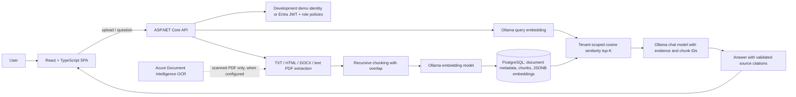

# Enterprise RAG Platform — project showcase

A portfolio-ready, local-first retrieval-augmented generation prototype that demonstrates document ingestion, chunking, vector retrieval, and evidence-cited answers using a cleanly separated .NET API and React UI.

> **Scope note:** This repository contains a working local RAG path and Azure integration adapters—not a production Azure deployment. The local PostgreSQL retriever scans stored JSON embeddings in application memory and is intended for small demonstrations. The architecture guide distinguishes implemented behavior from future production work.

## At a glance

| Area | Implemented in the local demo |
|---|---|
| API | .NET 9 / ASP.NET Core, controller boundaries, dependency injection |
| Web app | React, TypeScript, Vite; document upload and question-answer workspace |
| Ingestion | TXT, HTML, DOCX, and selectable-text PDF extraction; 20 MB service limit |
| Chunking | Recursive text chunking with overlap |
| Models | Ollama chat and embeddings; configurable model names (for example Qwen 3 1.7B and `nomic-embed-text`) |
| Index | PostgreSQL metadata, chunks, and JSONB embeddings; cosine-similarity top-K retrieval in the API |
| Answers | Evidence-conditioned generation; model citation labels are validated against retrieved chunks; if omitted, the highest-ranked retrieved chunk is attached as a source |
| Identity | Development-only loopback demo identity; MSAL / Entra bearer-token and role-policy path for configured deployments |
| Local runtime | Docker Compose for API, PostgreSQL, and frontend; Ollama runs on the host |
| Samples | Three synthetic, long-form validation documents and suggested questions in `samples/rag-validation/` |

## Runtime architecture (implemented local path)



The local retrieval implementation loads the current tenant's candidate embeddings and scores them in application memory. It does not provide production-scale vector search, lexical/BM25 hybrid search, or Azure AI Search semantic ranking.

## Ingestion and answer lifecycle

1. The user uploads an allowed file through the SPA.
2. The API validates the extension and size, computes a content hash, and extracts readable text. HTML script/style content is removed. Text-based PDFs use PdfPig; OCR is an optional Azure path for image-only PDFs.
3. Extracted content is recursively chunked (1,200 target characters with 180 characters overlap), then embedded in batches using Ollama.
4. A PostgreSQL transaction saves document metadata, chunks, and embeddings under the current tenant context. Re-uploading identical content for that tenant updates the indexed document.
5. For a question, the API generates one query embedding, calculates cosine similarity against indexed tenant chunks, and selects up to the configured top-K (default 8, maximum 20).
6. The chat model receives the question and retrieved evidence. Returned source labels are mapped only to retrieved chunk IDs; if the model omits citation syntax, the API attaches the highest-ranked retrieved chunk as a source instead of discarding the answer.

The response confidence value is currently a placeholder (0), not a calibrated probability. Citations show which retrieved passages were used; they do not guarantee that the model interpreted every condition correctly.

## Run the local showcase

Prerequisites: Docker Desktop, .NET 9 SDK, Node.js 22, and Ollama installed on the host. A GPU is not required, though model latency depends on available hardware.

1. Copy `.env.example` to `.env`; set a unique local `POSTGRES_PASSWORD`. To use the smaller model tested for this demo, set `OLLAMA_CHAT_MODEL=qwen3:1.7b` and `OLLAMA_EMBEDDING_MODEL=nomic-embed-text`.
2. In a separate PowerShell window, start Ollama and fetch the models:

   ```powershell
   ollama pull qwen3:1.7b
   ollama pull nomic-embed-text
   ```

3. From the repository root, build and start the app:

   ```powershell
   docker compose up --build
   ```

4. Open `http://localhost:3000`, upload the three files under `samples/rag-validation/` individually, and ask questions from that folder's README. The API is at `http://localhost:5283`; readiness is `http://localhost:5283/health/ready`.

The Compose API container connects to the host Ollama service at `host.docker.internal:11434`. On Windows, if that connection is refused, consult the root README for the Ollama host binding and firewall warning. Demo authentication is intended only for local development; the API and frontend host ports bind to loopback, while PostgreSQL is not published to the host.

## Validation walkthrough

Use the sample question set to probe more than happy-path retrieval:

- **Exact fact:** mileage rate and effective date in the travel policy.
- **Rule composition:** required approvers for an international trip above USD 3,000.
- **Important distinctions:** first-response target versus resolution guarantee in the support playbook.
- **Format extraction:** HTML text should exclude its embedded script/style text.
- **OCR boundary:** ordinary selectable-text PDF versus image-only PDF.
- **Abstention:** no release date is promised for the sample export feature.

Record the answer and citation, then verify every condition against the source. This is a manual demonstration set, not a scored evaluation benchmark.

## Azure-ready direction (not a deployed environment)

The solution includes Azure-oriented Semantic Kernel / Azure OpenAI and Azure AI Search adapters, plus infrastructure configuration points. The deployment diagram, private networking, managed identities, background ingestion, scalable index lifecycle, telemetry/cost accounting, and full offline evaluation remain architecture/roadmap items. No cloud environment is provisioned by this repository. Before any production use, complete the hardening and roadmap in [`architecture.md`](architecture.md), including moving from unsupported .NET 9 to .NET 10 LTS.

## Presentation deck

The 12-slide [`enterprise-rag-showcase.pptx`](enterprise-rag-showcase.pptx) is generated from [`scripts/generate_showcase_deck.py`](../scripts/generate_showcase_deck.py). Regenerate it after installing `python-pptx` with `py -m pip install python-pptx` and running `py scripts/generate_showcase_deck.py` from the repository root.

## Repository map

```text
Controllers/                         HTTP endpoints and request context
src/Enterprise.Rag.Domain/           Domain entities and invariants
src/Enterprise.Rag.Application/      Ingestion/query use cases and ports
src/Enterprise.Rag.Infrastructure/   Ollama, PostgreSQL, PDF and Azure adapters
frontend/                             React + TypeScript SPA
db/schema.sql                         PostgreSQL schema
samples/rag-validation/               Synthetic multi-format test corpus
docs/architecture.md                 Target architecture, security and roadmap
docs/project-showcase.md              This implementation overview
docs/resume-project.md                Accurate resume wording and demo narrative
docs/enterprise-rag-showcase.pptx     Portfolio presentation
scripts/generate_showcase_deck.py     Reproducible PowerPoint source
```

## Current limitations worth mentioning in a technical interview

- .NET 9 is out of support; target .NET 10 LTS before production deployment.
- PostgreSQL JSONB embeddings are scored in application memory; this is for a small local corpus, not scalable vector search.
- Query rewriting, expansion, a dedicated reranker, calibrated confidence, and a scored evaluation suite are not implemented in the local flow.
- Synchronous ingestion does not yet include malware scanning, durable source-file storage, job queue/retries, or lifecycle/status management.
- The local demo identity bypasses external sign-in by design and must never be exposed beyond local development.
- The Azure deployment described in the architecture blueprint is not currently provisioned or production-validated.
